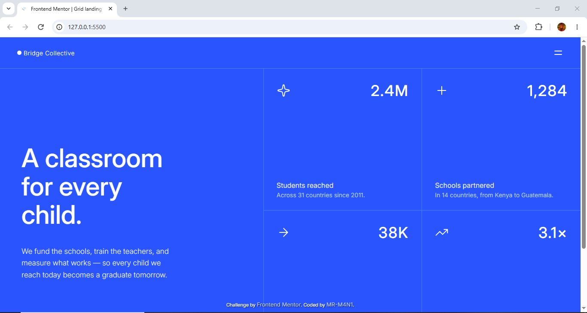
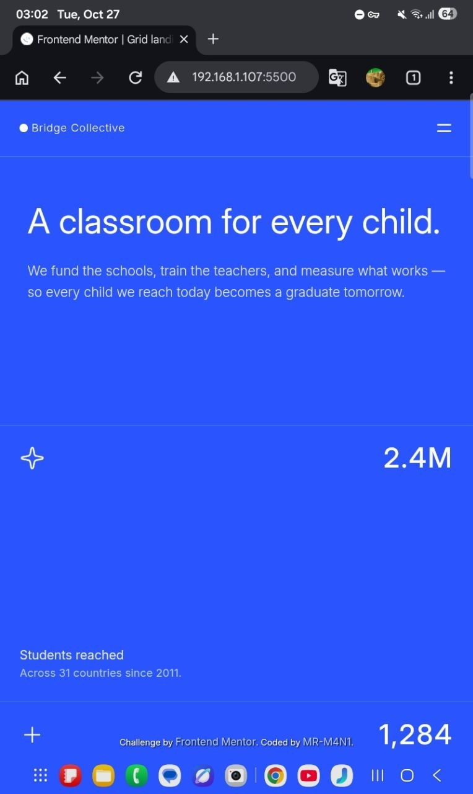
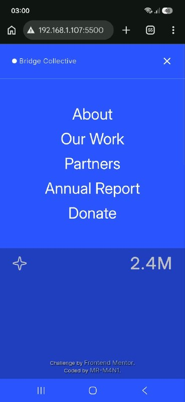
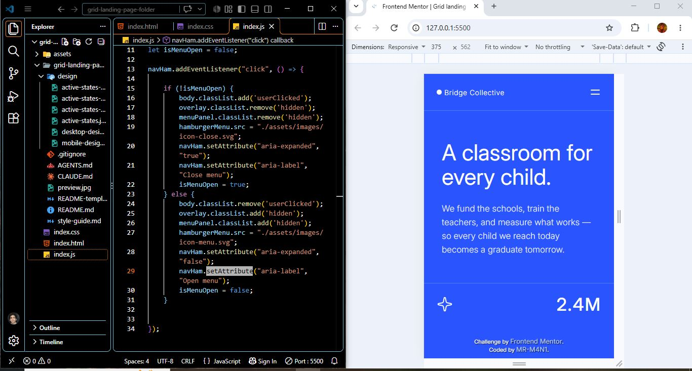

# Grid-landing-page
This is a my solution to the Grid landing page challenge on Frontend Mentor

# Frontend Mentor - Grid landing page solution

This is a solution to the [Grid landing page challenge on Frontend Mentor](https://www.frontendmentor.io/challenges/grid-landing-page). Frontend Mentor challenges help you improve your coding skills by building realistic projects. 

## Table of contents

- [Overview](#overview)
  - [The challenge](#the-challenge)
  - [Screenshot](#screenshot)
  - [Links](#links)
- [My process](#my-process)
  - [Built with](#built-with)
  - [What I learned](#what-i-learned)
  - [Continued development](#continued-development)
  - [Useful resources](#useful-resources)
  - [AI Collaboration](#ai-collaboration)
- [Author](#author)
- [Acknowledgments](#acknowledgments)

## Overview

The page introduces the organization's mission and displays four impact statistics. It features a responsive layout, a navigation menu that opens and closes with JavaScript, and interactive hover effects

### The challenge

Users should be able to:

- View the optimal layout for the page depending on their device's screen size
- See hover and focus states for all interactive elements on the page
- Open and close the navigation menu at any screen size (optional JavaScript)

### Screenshot





### Links

- Solution URL: [Click here for Solution]()
- Live Site URL: [Click here for Live Site]()

## My process



### Built with

- HTML5
- CSS3
- Flexbox
- CSS Grid
- CSS custom properties
- Media queries
- Vanilla JavaScript
- Inter variable font

### What I learned

This project helped me improve my understanding of responsive layouts and how CSS positioning works.

1. Using CSS Grid and Flexbox

I practiced using Flexbox for arranging elements and CSS Grid for creating the two-column statistics layout on desktop.

```css
.statsSection {
    display: grid;
    grid-template-columns: repeat(2, 1fr);
    grid-template-rows: repeat(2, 1fr);
}
```

2. Understanding CSS positioning

I explored the differences between position: relative, position: absolute, and position: fixed, particularly how the containing block affects the position of a navigation menu.

```css
body{
  position: relative;
}

nav{
  position: absolute;
}
```
3.How to use setAttribute() to dynamically update HTML attributes

 such as aria-expanded and aria-label, when opening and closing the navigation menu.

```js
navHam.setAttribute("aria-expanded", "true");
navHam.setAttribute("aria-label", "Close menu");
```

### Continued development

- mprove my workflow to complete projects more efficiently and in less time.

- Increase my coding speed and become more confident when implementing designs.

- Plan my work more effectively, set clear goals, and follow a more structured approach throughout each project.

### AI Collaboration

I used ChatGPT as a learning assistant throughout this project. It helped me understand HTML, CSS, and JavaScript concepts, review my code, troubleshoot layout and navigation issues, and learn about accessibility and responsive design.

I used its explanations and suggestions to improve my understanding and make better decisions while developing the project, rather than relying on AI to generate the entire solution.

## Author

- Frontend Mentor - [@MR-M4N1](https://www.frontendmentor.io/profile/MR-M4N1)
- Pinterest - [@MR-M4N1](https://www.pinterest.com/mrm4n1/?invite_code=4dc73b0e43814c3395c2f9600625eb5d&sender=1093671228168293050)
- LinkedIn - [@mani-ghorbanian](https://www.linkedin.com/in/mani-ghorbanian-351820327/)

## Acknowledgments

Thanks to Frontend Mentor for providing this challenge and the design resources that helped guide my implementation.
